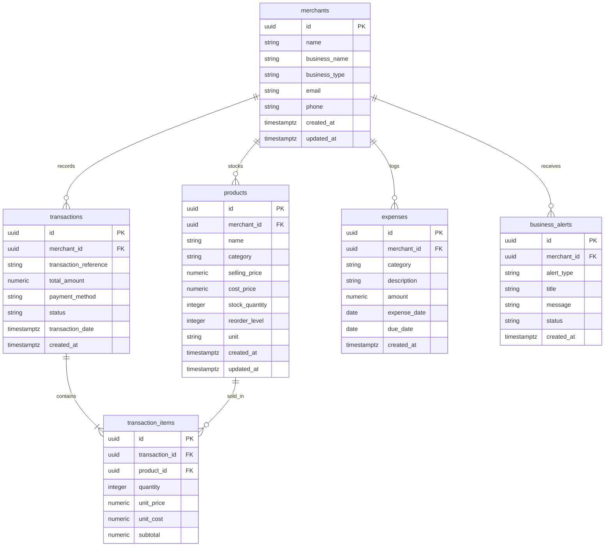

# SETU Database Data Dictionary & Schema Documentation

The SETU database foundation is powered by **Supabase PostgreSQL**. This document outlines all tables, fields, constraints, foreign key relationships, performance indexes, and Row Level Security recommendations.

---

## 1. Entity-Relationship Overview



---

## 2. Table Specifications

### 2.1 Table: `merchants`
Stores identity and contact information for registered business owners.

| Column | Type | Constraints | Description |
| :--- | :--- | :--- | :--- |
| `id` | `UUID` | `PRIMARY KEY, DEFAULT gen_random_uuid()` | Unique identifier for merchant |
| `name` | `VARCHAR(255)` | `NOT NULL` | Full name of merchant owner |
| `business_name`| `VARCHAR(255)` | `NOT NULL` | Registered trading name (e.g. Lakshmi Provision Store) |
| `business_type`| `VARCHAR(100)` | `NOT NULL` | Business category (Kirana, Pharmacy, Retail) |
| `email` | `VARCHAR(255)` | `UNIQUE, NOT NULL` | Login / contact email |
| `phone` | `VARCHAR(50)` | `NULLABLE` | Contact phone number |
| `created_at` | `TIMESTAMPTZ` | `NOT NULL, DEFAULT NOW()` | Record creation timestamp |
| `updated_at` | `TIMESTAMPTZ` | `NOT NULL, DEFAULT NOW()` | Automatically maintained via trigger |

---

### 2.2 Table: `products`
Master catalog of items stocked by merchants, tracking pricing and inventory levels.

| Column | Type | Constraints | Description |
| :--- | :--- | :--- | :--- |
| `id` | `UUID` | `PRIMARY KEY, DEFAULT gen_random_uuid()` | Unique product identifier |
| `merchant_id` | `UUID` | `NOT NULL, REFERENCES merchants(id) ON DELETE CASCADE` | Owning merchant |
| `name` | `VARCHAR(255)` | `NOT NULL` | Product name (e.g. Aashirvaad Atta 10kg) |
| `category` | `VARCHAR(100)` | `NOT NULL` | Category (Staples, Dairy, Edible Oils) |
| `selling_price`| `NUMERIC(12,2)`| `NOT NULL, CHECK (selling_price >= 0)` | Customer retail price |
| `cost_price` | `NUMERIC(12,2)`| `NOT NULL, CHECK (cost_price >= 0)` | Wholesale acquisition cost |
| `stock_quantity`| `INTEGER` | `NOT NULL, DEFAULT 0, CHECK (stock_quantity >= 0)` | Current units on shelf/godown |
| `reorder_level`| `INTEGER` | `NOT NULL, DEFAULT 10, CHECK (reorder_level >= 0)` | Critical restock alert threshold |
| `unit` | `VARCHAR(50)` | `NOT NULL, DEFAULT 'piece'` | Unit of measure (bag, pouch, kg, piece) |
| `created_at` | `TIMESTAMPTZ` | `NOT NULL, DEFAULT NOW()` | Creation timestamp |
| `updated_at` | `TIMESTAMPTZ` | `NOT NULL, DEFAULT NOW()` | Automatically maintained via trigger |

**Table Constraints:**
- `CONSTRAINT chk_positive_margin CHECK (selling_price >= cost_price)`

---

### 2.3 Table: `transactions`
Records customer sales checkouts and payment settlements.

| Column | Type | Constraints | Description |
| :--- | :--- | :--- | :--- |
| `id` | `UUID` | `PRIMARY KEY, DEFAULT gen_random_uuid()` | Unique transaction ID |
| `merchant_id` | `UUID` | `NOT NULL, REFERENCES merchants(id) ON DELETE CASCADE` | Owning merchant |
| `transaction_reference` | `VARCHAR(100)` | `UNIQUE, NOT NULL` | Unique invoice or UPI reference |
| `total_amount` | `NUMERIC(12,2)`| `NOT NULL, CHECK (total_amount >= 0)` | Total payable amount in INR |
| `payment_method` | `VARCHAR(50)` | `NOT NULL, CHECK (IN ('UPI', 'Cash', 'Card', 'NetBanking', 'Wallet'))` | Payment mode |
| `status` | `VARCHAR(50)` | `NOT NULL, DEFAULT 'completed', CHECK (IN ('completed', 'pending', 'failed', 'refunded'))` | Settlement status |
| `transaction_date` | `TIMESTAMPTZ` | `NOT NULL, DEFAULT NOW()` | Timestamp of sale event |
| `created_at` | `TIMESTAMPTZ` | `NOT NULL, DEFAULT NOW()` | Audit timestamp |

---

### 2.4 Table: `transaction_items`
Individual line items purchased within each transaction.

| Column | Type | Constraints | Description |
| :--- | :--- | :--- | :--- |
| `id` | `UUID` | `PRIMARY KEY, DEFAULT gen_random_uuid()` | Line item identifier |
| `transaction_id`| `UUID` | `NOT NULL, REFERENCES transactions(id) ON DELETE CASCADE` | Associated transaction |
| `product_id` | `UUID` | `NOT NULL, REFERENCES products(id) ON DELETE RESTRICT` | Referenced product |
| `quantity` | `INTEGER` | `NOT NULL, CHECK (quantity > 0)` | Count of units purchased |
| `unit_price` | `NUMERIC(12,2)`| `NOT NULL, CHECK (unit_price >= 0)` | Price per unit at time of sale |
| `unit_cost` | `NUMERIC(12,2)`| `NOT NULL, CHECK (unit_cost >= 0)` | Cost per unit at time of sale |
| `subtotal` | `NUMERIC(12,2)`| `NOT NULL, CHECK (subtotal >= 0)` | `quantity * unit_price` |

---

### 2.5 Table: `expenses`
Operational expenses, recurring utility bills, and wholesale vendor invoices.

| Column | Type | Constraints | Description |
| :--- | :--- | :--- | :--- |
| `id` | `UUID` | `PRIMARY KEY, DEFAULT gen_random_uuid()` | Unique expense record ID |
| `merchant_id` | `UUID` | `NOT NULL, REFERENCES merchants(id) ON DELETE CASCADE` | Owning merchant |
| `category` | `VARCHAR(100)` | `NOT NULL` | Utilities, Rent, Supplier, Salary |
| `description` | `TEXT` | `NULLABLE` | Line description or payee name |
| `amount` | `NUMERIC(12,2)`| `NOT NULL, CHECK (amount >= 0)` | Invoice amount in INR |
| `expense_date`| `DATE` | `NOT NULL, DEFAULT CURRENT_DATE` | Date incurred or billed |
| `due_date` | `DATE` | `NULLABLE` | Payment due date |
| `created_at` | `TIMESTAMPTZ` | `NOT NULL, DEFAULT NOW()` | Record creation timestamp |

---

### 2.6 Table: `business_alerts`
Actionable business notices generated by analytics algorithms and AI monitors.

| Column | Type | Constraints | Description |
| :--- | :--- | :--- | :--- |
| `id` | `UUID` | `PRIMARY KEY, DEFAULT gen_random_uuid()` | Unique alert ID |
| `merchant_id` | `UUID` | `NOT NULL, REFERENCES merchants(id) ON DELETE CASCADE` | Owning merchant |
| `alert_type` | `VARCHAR(50)` | `NOT NULL, CHECK (IN ('low_stock', 'cash_flow', 'sales_spike', 'payment_pending', 'general'))` | Type classification |
| `title` | `VARCHAR(255)` | `NOT NULL` | Alert headline |
| `message` | `TEXT` | `NOT NULL` | Detailed explanation & recommended action |
| `status` | `VARCHAR(50)` | `NOT NULL, DEFAULT 'active', CHECK (IN ('active', 'dismissed', 'resolved'))` | State of alert |
| `created_at` | `TIMESTAMPTZ` | `NOT NULL, DEFAULT NOW()` | Alert generation timestamp |

---

## 3. Database Indexes

To guarantee sub-10ms response times on high-volume queries:

1. `idx_products_merchant_id`: Fast filtering of catalog by merchant.
2. `idx_transactions_merchant_date`: Accelerates time-range aggregation (`DESC` order for recent sales).
3. `idx_transaction_items_tx_id`: Instant retrieval of line items for a given receipt.
4. `idx_transaction_items_prod_id`: Fast calculation of top selling product volume.
5. `idx_expenses_merchant_date`: Rapid monthly operating expense tallying.
6. `idx_business_alerts_merchant_status`: Rapid lookup of pending notifications (`status = 'active'`).
7. `idx_products_reorder`: Composite index on `(merchant_id, stock_quantity, reorder_level)` to immediately find low-stock items.

---

## 4. Production Row Level Security (RLS) Recommendations

All tables have RLS enabled:
```sql
ALTER TABLE merchants ENABLE ROW LEVEL SECURITY;
ALTER TABLE products ENABLE ROW LEVEL SECURITY;
ALTER TABLE transactions ENABLE ROW LEVEL SECURITY;
ALTER TABLE transaction_items ENABLE ROW LEVEL SECURITY;
ALTER TABLE expenses ENABLE ROW LEVEL SECURITY;
ALTER TABLE business_alerts ENABLE ROW LEVEL SECURITY;
```

When integrating Supabase Auth in production, apply the following policies:

```sql
-- Merchant profile policy
CREATE POLICY "Merchants view own profile"
ON merchants FOR ALL
USING (auth.uid() = id);

-- Products policy
CREATE POLICY "Merchants view and modify own products"
ON products FOR ALL
USING (auth.uid() = merchant_id)
WITH CHECK (auth.uid() = merchant_id);

-- Transactions policy
CREATE POLICY "Merchants view own transactions"
ON transactions FOR ALL
USING (auth.uid() = merchant_id);

-- Transaction items policy
CREATE POLICY "Merchants view transaction items for their own sales"
ON transaction_items FOR ALL
USING (
  EXISTS (
    SELECT 1 FROM transactions
    WHERE transactions.id = transaction_items.transaction_id
    AND transactions.merchant_id = auth.uid()
  )
);
```

